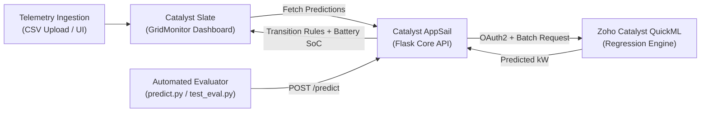

# HackSphere 3.0: Smart Energy Microgrid & Demand Forecasting Engine

An end-to-end intelligent energy management and demand forecasting platform built and deployed on **Zoho Catalyst**. It forecasts hourly energy demand for 24-hour windows using **Zoho Catalyst QuickML** regression models and triggers automated power dispatch transition signals between the Main Grid and Renewable Battery Storage.

---

## 🌟 Live Deployments

* **Frontend Dashboard (Catalyst Slate):** [https://gridmonitor-ipxuywnu.onslate.in](https://gridmonitor-ipxuywnu.onslate.in)
* **Backend Forecast API (Catalyst AppSail):** [https://microgrid-core-api-50047212280.development.catalystappsail.in](https://microgrid-core-api-50047212280.development.catalystappsail.in)
* **QuickML Prediction Endpoint:** `https://api.catalyst.zoho.in/quickml/v1/project/101065000000013024/endpoints/predict`

---

## ⚡ Key Capabilities

1. **Demand Forecasting Pipeline (QuickML):**
   * Machine learning regression model trained on historical weather and telemetry data (`ambient_temp_c`, `humidity_pct`, `solar_irradiance_wm2`, and engineered temporal feature `hour`).
   * Accurately predicts 24-hour demand curves (kW).
2. **Smart Grid Transition Controller:**
   * **Renewable Storage Mode:** Activated when predicted load $> 160\text{ kW}$ **OR** during peak hours between **18:00 and 22:00 inclusive**.
   * **Main Grid Mode:** Active when demand $\le 160\text{ kW}$ outside the peak window.
   * **Critical Overload Alert:** Independent alarm raised whenever predicted load $\ge 200\text{ kW}$.
   * **Dynamic Battery Simulation:** Monitors simulated battery state-of-charge (SoC, 600 kWh capacity) through discharge and charging cycles.
3. **Interactive Web Dashboard (GridMonitor):**
   * Real-time SVG demand curve visualization with active state badges.
   * Telemetry data ingestion via interactive UI forms or CSV file upload.
   * Exportable predictions and full telemetry logs in CSV and JSON formats.

---

## 🏗️ Architecture Overview



| Component | Catalyst Service | Description |
| :--- | :--- | :--- |
| **Frontend** | **Catalyst Slate** | Responsive React & Vite dashboard (`GridMonitor`) |
| **Backend API** | **Catalyst AppSail** | Python 3.9 Flask microservice with CORS & transition logic |
| **ML Engine** | **Catalyst QuickML** | Published regression model forecasting hourly kW demand |

---

## 🔌 API Reference

### 1. Health Check
* **`GET /`**
* **Response:**
  ```json
  {
    "status": "success",
    "message": "Microgrid Demand-Forecasting API is online and running on Catalyst Python 3.9",
    "quickml_configured": true
  }
  ```

### 2. Batch Demand Forecasting
* **`POST /predict`**
* **Request Body:**
  ```json
  {
    "rows": [
      {
        "timestamp": "2024-01-01 12:00:00",
        "ambient_temp_c": 22.0,
        "humidity_pct": 55.0,
        "solar_irradiance_wm2": 600.0
      }
    ]
  }
  ```
* **Response:**
  ```json
  {
    "status": "success",
    "forecast": [
      {
        "timestamp": "2024-01-01 12:00:00",
        "predicted_demand_kw": 142.50,
        "grid_mode": "Main Grid Mode",
        "critical_overload": false,
        "battery_soc_pct": 92.5
      }
    ]
  }
  ```

### 3. CSV File Upload
* **`POST /predict-csv`** (or `POST /forecast` with multipart form data)

---

## 🧪 Local Setup & Evaluation

### Prerequisites
* Python 3.9+
* Node.js 18+ (for frontend dashboard)
* Zoho Catalyst CLI (`zcatalyst-cli`)

### Running the Evaluator Test
Before submission, verify that `predict.py` complies with the hackathon evaluation contract:

```bash
# Run pre-submission self-test
python test_eval.py
```

Expected output:
```
  HACKSPHERE 3.0 - Pre-Submission Self-Tester    
 Found 'predict.py'.
 Found 'sample_test_input.csv'.
 Successfully imported 'predict(input_df)' function.
Loaded 1000 test rows from 'sample_test_input.csv'.
Your predict.py script is completely valid!
SUCCESS
```

### Running the Forecast Script Locally
```bash
python predict.py --input sample_test_input.csv --output predictions.csv
```

---

## 📂 Repository Structure

```
├── app.py                      # Flask backend API entrypoint
├── app-config.json             # Catalyst AppSail configuration
├── catalyst.json               # Catalyst project service manifest
├── predict.py                  # Official hackathon prediction template
├── test_eval.py                # Pre-submission verification script
├── test_api.py                 # Remote endpoint validation test
├── transform.py                # Feature engineering script (timestamp -> hour)
├── sample_test_input.csv       # Sample test dataset (20% split)
├── train_telemetry.csv         # Training telemetry dataset
├── train_telemetry_engineered.csv # Transformed dataset with engineered hour column
├── microgrid-core-api/         # AppSail service source directory
│   ├── app.py                  # Core backend API implementation
│   ├── app-config.json         # Service-level AppSail configuration
│   └── requirements.txt        # Backend dependencies
├── GridMonitor/                # Frontend dashboard application (Slate)
│   ├── src/                    # React UI components & SVG charts
│   ├── index.html              # Dashboard HTML template
│   └── package.json            # Frontend dependencies
└── README.md                   # Project documentation
```

---

## 🔐 Environment Variables

The AppSail service reads the following configuration securely via environment variables:

| Variable | Description |
| :--- | :--- |
| `HS_QML_URL` | Zoho Catalyst QuickML endpoint URL |
| `HS_QML_KEY` | QuickML endpoint authorization key |
| `HS_ORG_ID` | Catalyst Organization ID |
| `HS_QML_ENV` | QuickML environment (`Development` / `Production`) |
| `HS_CLIENT_ID` | Zoho OAuth Client ID |
| `HS_CLIENT_SECRET` | Zoho OAuth Client Secret |
| `HS_REFRESH_TOKEN` | Zoho OAuth Refresh Token |

---

## 👥 Authors
* **Team:** HackSphere 3.0
* **Platform:** Zoho Catalyst (AppSail, Slate, QuickML)
